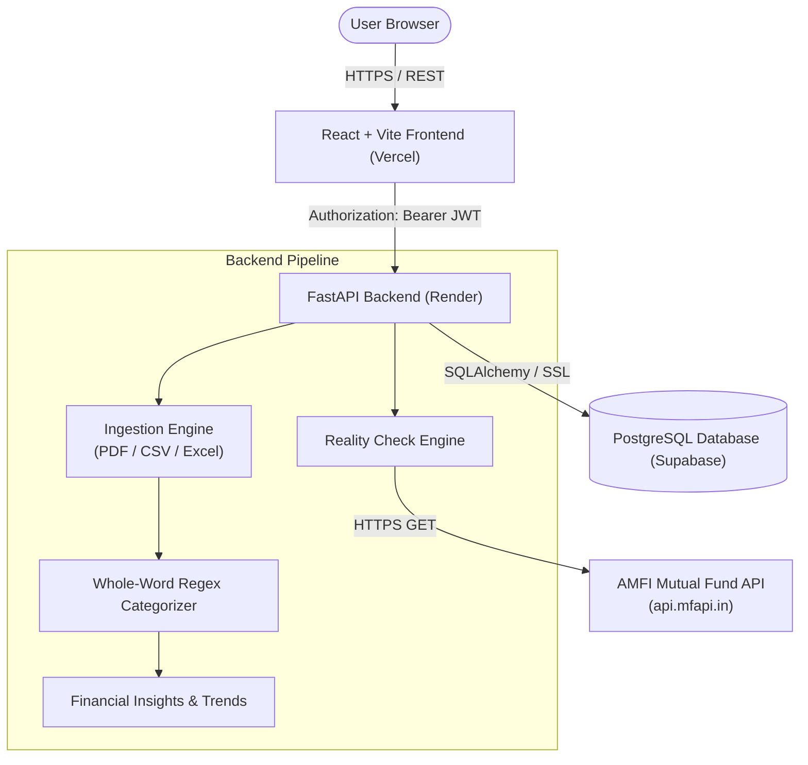

# PaisaClarity

**PaisaClarity** is a personal finance assistant designed for Indian banking and investment ecosystems. It allows users to upload bank and credit card statements (PDF, CSV, Excel), automatically parses and categorizes transactions, detects recurring subscriptions and anomalous spending, and provides a "reality check" comparison between actual investment returns (via live AMFI Mutual Fund NAVs) and traditional insurance policies.

---

## Live Demo

- **Frontend (Vercel)**: `<!-- TODO: Insert your Vercel deployment URL here, e.g. https://paisa-clarity.vercel.app -->`
- **Backend API (Render)**: `<!-- TODO: Insert your Render API URL here, e.g. https://paisa-clarity-api.onrender.com -->`

> **Note on Free-Tier Hosting**: The backend is hosted on Render's free tier. If the service has been inactive, the initial request may take 30–60 seconds while the backend container spins up (cold start). Subsequent requests will respond normally.

---

## Features & Implementation Status

| Feature | Description | Status |
|---|---|---|
| **Multi-Format Statement Ingestion** | Extracts transactions from PDF (borderless/bordered tables via pdfplumber), CSV, and Excel (.xlsx, .xls) files. Validates PDF magic bytes (`%PDF-`) and enforces a 10MB file size ceiling. | Supported |
| **Deterministic Categorization** | Uses a whole-word regex pattern-matching engine with keyword stems for 12 categories (Food, Groceries, Shopping, Entertainment, Utilities, Healthcare, Travel, etc.). | Supported |
| **Spending Insights & Trends** | Computes monthly spend breakdowns, month-over-month category percentage trends, and next-month spending forecasts. | Supported |
| **Anomaly & Subscription Detection** | Highlights unusually high transactions ($>2\times$ category average) and detects recurring monthly subscription charges. | Supported |
| **Reality Check & Live NAV Valuation** | Fetches live Net Asset Values (NAV) for Indian mutual funds from the official AMFI API (`mfapi.in`) and calculates current portfolio values and premiums. | Supported |
| **Investment Portfolio Tracking** | Tracks market assets (stocks, mutual funds) alongside policy assets (term insurance, endowment plans). | Supported |
| **Duplicate Detection** | Generates a deterministic transaction hash key (`date_amount_normalized_description`) to prevent duplicate entry processing. | Supported |
| **Authentication & Protection** | 12-round bcrypt password hashing, signed JWT tokens, rate limiting on sensitive routes, and production secret enforcement. | Supported |
| **Health Probes** | Independent liveness (`/health`) and readiness (`/health/ready`) endpoints for automated uptime monitoring and orchestrators. | Supported |

---

## Architecture



---

## Tech Stack

- **Backend**: Python 3.11, [FastAPI](https://fastapi.tiangolo.com/), [SQLAlchemy](https://www.sqlalchemy.org/), [Alembic](https://alembic.sqlalchemy.org/), [Pydantic v2](https://docs.pydantic.dev/), [SlowAPI](https://github.com/laurentS/slowapi) (rate limiting), [pdfplumber](https://github.com/jsvine/pdfplumber), [Pandas](https://pandas.pydata.org/).
- **Frontend**: [React 18](https://react.dev/), [Vite](https://vitejs.dev/), [Tailwind CSS](https://tailwindcss.com/), [Lucide React](https://lucide.dev/), [Recharts](https://recharts.org/).
- **Database & Storage**: [PostgreSQL](https://www.postgresql.org/) (via [Supabase](https://supabase.com/)), fallback to SQLite for zero-config local development and automated testing.
- **Testing & Tooling**: [Pytest](https://docs.pytest.org/), [Docker](https://www.docker.com/), [GitHub Actions](https://github.com/features/actions).

---

## Local Setup

### Option 1: Without Docker (Standard Python & Node.js)

#### Prerequisites
- Python 3.11+
- Node.js 20+ and npm

#### 1. Backend Setup
```bash
# Navigate to backend directory
cd backend

# Create and activate a virtual environment
python -m venv venv
# On Windows:
.\venv\Scripts\activate
# On Linux/macOS:
source venv/bin/activate

# Install dependencies
pip install -r requirements.txt
pip install -r requirements-dev.txt

# Configure environment variables
cp .env.example .env
# Edit .env as needed (by default it will safely fall back to local SQLite)

# Start development server
uvicorn main:app --reload --port 8000
```
Backend API will be running at `http://127.0.0.1:8000` (Swagger docs available at `http://127.0.0.1:8000/docs`).

#### 2. Frontend Setup
```bash
# Navigate to frontend directory
cd frontend-react

# Install dependencies
npm install

# Start Vite dev server
npm run dev
```
Frontend UI will be running at `http://localhost:5173`.

---

### Option 2: With Docker & Docker Compose

Docker Compose provisions a local PostgreSQL 16 container and builds the backend container automatically.

```bash
# From repository root:
docker compose up --build
```

- Backend API: `http://localhost:8000`
- PostgreSQL: `localhost:5432` (`paisaclarity`)

To run database migrations against the containerized PostgreSQL instance:
```bash
docker compose run --rm backend alembic upgrade head
```

---

## Environment Variables

### Backend Configuration (`backend/.env`)

| Variable | Required? | Default | Purpose |
|---|---|---|---|
| `ENVIRONMENT` | Optional | `development` | Set to `production` in production (or auto-detected via `RENDER`). Rejects weak secrets and requires Postgres. |
| `DATABASE_URL` | Optional | *(falls back to SQLite in dev)* | PostgreSQL connection URI (e.g. Supabase connection string). |
| `SECRET_KEY` | Optional in dev, **Required in prod** | `change-me-to-a-long-random-string...` | Cryptographic secret used to sign and verify JWT tokens (min 32 characters in production). |
| `ALLOWED_ORIGINS` | Optional | `http://localhost:5173,http://127.0.0.1:5173` | Comma-separated list of allowed frontend origins for CORS. |
| `RATE_LIMIT_ENABLED` | Optional | `true` | Toggles authentication rate limiting on `/auth/login` and `/auth/signup`. |
| `RATE_LIMIT_LOGIN` | Optional | `10/minute` | Rate limit ceiling for login requests per client IP. |
| `RATE_LIMIT_SIGNUP` | Optional | `5/minute` | Rate limit ceiling for signup requests per client IP. |
| `TRUST_PROXY_HEADERS` | Optional | `false` | When true (or when on Render), inspects trusted reverse-proxy headers for client IP. |
| `PROXY_HEADER_ORDER` | Optional | `cf-connecting-ip,true-client-ip` | Comma-separated priority order for upstream edge proxy headers. |
| `AUTO_CREATE_TABLES` | Optional | `true` | Controls whether `Base.metadata.create_all()` executes on startup. Set to `false` when using strict Alembic migrations. |
| `LLM_API_KEY` | Optional | `""` | Reserved for future AI advisor feature. |

### Frontend Configuration (`frontend-react/.env`)

| Variable | Required? | Default | Purpose |
|---|---|---|---|
| `VITE_API_URL` | Optional | `http://localhost:8000` | Base URL pointing to the FastAPI backend API service. |

---

## Running Tests

All automated tests run without requiring any external credentials or services (using an isolated SQLite in-memory database):

```bash
# Run backend test suite
cd backend
pytest -q

# Run with test coverage report
pytest --cov=. --cov-report=term-missing

# Run frontend build check
cd ../frontend-react
npm run build
```

---

## Migrations

Database schema migrations are version-controlled using Alembic under `backend/alembic/`.
- Run migrations: `cd backend && alembic upgrade head`
- Roll back last migration: `cd backend && alembic downgrade -1`
- Detailed production migration and zero-downtime transition instructions: see [docs/migrations-plan.md](docs/migrations-plan.md).

---

## Security Notes

1. **Password Hashing**: User passwords are encrypted with `bcrypt` (12-round work factor) before storage. Plain-text passwords are never saved.
2. **Password Validation**: New user signups must meet minimum complexity ($\ge 8$ characters, not purely numeric, $\le 72$ UTF-8 bytes). The byte cap eliminates a native bcrypt C-library crash (HTTP 500) on oversized payloads.
3. **Stateless JWT Tokens**: Signed using HMAC-SHA256 with user ID payloads and a 24-hour expiration window.
4. **Data Isolation & Ownership**: All queries for statements, investments, and transactions strictly filter by `current_user.id` resolved from validated tokens.
5. **Anti-Spoofing Rate Limiting**: Sensitive auth routes are rate-limited via SlowAPI. In production on Render, the system prioritizes non-forgeable Cloudflare edge headers (`CF-Connecting-IP` / `True-Client-IP`) and ignores attacker-controlled leftmost `X-Forwarded-For` values. See [docs/auth-notes.md](docs/auth-notes.md).
6. **Upload Sanitization**: Enforces a strict 10MB payload ceiling and validates initial file headers (`%PDF-`) to reject malformed or malicious uploads.
7. **Production Fail-Fast**: When `ENVIRONMENT=production`, startup crashes early if the database is unreachable or if insecure default credentials are used.

---

## Known Limitations

- **In-Memory Rate Limiter**: Rate limit counters are tracked in application memory. Counters reset on service restart or redeploy. For multi-worker scaling, a Redis backend is recommended.
- **Statement Storage Format**: Parsed transactions are currently stored as a serialized JSON blob on the `Statement` record rather than normalized individual transaction table rows.
- **Rule-Based Categorization**: Categorization uses a first-match-wins regex keyword dictionary. It does not use machine learning or natural language models, so unrecognized merchants fall into `Other Expense`.
- **JWT Lifespan & Token Refresh**: Authentication tokens expire after 24 hours without automatic silent refresh. When expired, users must log in again.
- **Cold Starts**: On free-tier cloud platforms (Render), the backend spins down after inactivity, causing a ~30–50s delay on the first request.

---

## Screenshots

<!-- TODO: Capture screenshots of your running application and save them into docs/images/ -->
- **Dashboard & Monthly Summary**:
  `<!-- TODO:  -->`
- **Statement Analysis & Spending Breakdown**:
  `<!-- TODO:  -->`
- **Reality Check vs Mutual Fund Returns**:
  `<!-- TODO:  -->`

---

## Key Design Decisions & Learnings

1. **Privacy-First Statement Processing**: Uploaded bank statements and credit card summaries are processed in-memory during ingestion and immediately discarded. Raw PDF and CSV documents containing account numbers or personal details are never persisted to disk or object storage.
2. **Whole-Word Regex Tokenization**: Replaced naive substring matching with regex word-boundary patterns (`\b(keyword)\b`). This eliminates false positives (e.g. matching "PVR" inside unrelated words while properly identifying "UPI/PVR") while preserving clean duplicate-detection keys (`transaction_key`).
3. **Hardened Reverse-Proxy IP Resolution**: Addressed Render's reverse proxy behavior of appending rather than stripping incoming headers. The rate limiter inspects authenticated edge headers (`CF-Connecting-IP`) and takes the rightmost proxy hop, preventing IP spoofing bypasses.
4. **Non-Breaking Additive Evolution**: Database models, API schemas, and validation rules were evolved incrementally (e.g. making `start_date` optional in database schema but required on new policies via Pydantic validators), ensuring existing database records and tests remain intact.
5. **Financial Reality Check Modeling**: Designed a comparison engine that pairs AMFI mutual fund historical NAV performance with traditional insurance policies, calculating realistic returns based on actual payment frequencies and start dates.
