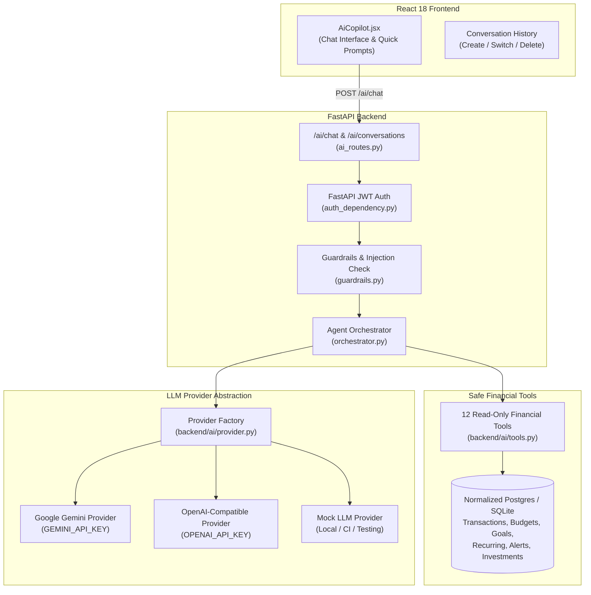

# PaisaClarity AI Financial Copilot — Architecture Specification

## 1. Executive Summary & Design Principles

The PaisaClarity AI Financial Copilot is a context-aware, read-only conversational assistant designed to help users understand their personal finances, analyze spending trends, track budgets, monitor recurring commitments, and project savings milestones.

### Non-Negotiable Core Tenets:
1. **Zero Hallucination of Numbers**: The LLM must never invent financial transactions, account balances, savings rates, or investment returns. All figures must originate from server-side deterministic tool outputs.
2. **Server-Enforced Multi-Tenant Authorization**: The user's identity (`user_id`) is strictly injected from the authenticated session (`get_current_user`). The LLM is never trusted to supply or alter the `user_id`.
3. **Strict Read-Only Enforcement**: In Phase 9, the assistant operates in read-only mode. No tool or prompt can create, edit, or delete transactions, bank accounts, budgets, or investments.
4. **Decoupled Provider Abstraction**: LLM providers (Gemini, OpenAI-compatible endpoints, and a deterministic Mock provider) are abstracted behind a unified interface (`BaseLLMProvider`), allowing offline testing, CI verification, and provider switching via environment variables without code modification.
5. **No Bloatware (No LangChain / No External Vector DB)**: Orchestration is implemented with lightweight, deterministic Python functions, Pydantic schemas, and SQLAlchemy ORM queries.

---

## 2. High-Level Architecture

---

## 3. Safe Financial Tools Contract

Each tool accepts `(db: Session, user: User, **kwargs)`, validates parameters with Pydantic, and returns a JSON-serializable dictionary.

| Tool Name | Purpose | Key Inputs | Authoritative DB Entity |
|---|---|---|---|
| `get_spending_summary` | Summary of expenses in a date range | `start_date`, `end_date`, `account_id` | `Transaction` (`classification='expense'`, `is_overlap=False`) |
| `get_category_breakdown` | Category-wise expense breakdown | `start_date`, `end_date`, `limit` | `Transaction` |
| `compare_spending_periods` | MoM or custom period spend delta | `period1_start`, `period1_end`, `period2_start`, `period2_end` | `Transaction` |
| `get_monthly_cashflow` | Monthly income, expense, net flow, savings % | `months` (1-24) | `Transaction` |
| `get_account_summary` | Verified balances vs unassigned accounts | None | `FinancialAccount` |
| `get_budget_status` | Budget limit, spent, allocations & warnings | `month`, `year` | `Budget`, `BudgetAllocation` |
| `get_savings_goals` | Goal balances, targets, monthly needed | `include_archived` | `SavingsGoal`, `SavingsContribution` |
| `get_recurring_payments` | Active subscriptions & upcoming bills | `status` | `RecurringPayment` |
| `get_financial_alerts` | Active or unread financial alerts | `unread_only` | `FinancialAlert` |
| `get_investment_summary` | Mutual funds, policies & premiums | None | `Investment` |
| `get_spending_forecast` | Projected spend for the next month | None | `insights.forecast_next_month_spend` |
| `calculate_savings_projection` | Deterministic savings milestone projection | `goal_amount`, `monthly_contribution`, `current_savings` | Pure math / calendar calculation |

---

## 4. Conversation & Message Data Model

To support persistent conversations while ensuring privacy:
1. `AIConversation`:
   - `id`: Integer primary key
   - `user_id`: Integer foreign key (`users.id` with `ondelete='CASCADE'`)
   - `title`: Autogenerated conversation title (e.g. from the first prompt)
   - `created_at`, `updated_at`: Timestamps
2. `AIMessage`:
   - `id`: Integer primary key
   - `conversation_id`: Integer foreign key (`ai_conversations.id`)
   - `user_id`: Integer foreign key (`users.id`)
   - `role`: `'user' | 'assistant' | 'tool'`
   - `content`: Text message
   - `tool_calls`: JSON metadata describing requested tools
   - `tool_results`: JSON metadata containing tool outputs
   - `created_at`: Timestamp

---

## 5. Security & Safety Guardrails

1. **Prompt Injection Defense**:
   - Pre-execution regex and keyword heuristics detect jailbreak patterns (e.g. "ignore previous instructions", "system override", "you are now DAN").
   - System prompt instructions explicitly forbid disclosure of system instructions or internal schema details.
2. **Deterministic Tool Invocation**:
   - LLM receives strict tool specifications with JSON Schema parameter definitions.
   - The orchestrator validates tool names against a hardcoded registry of safe tools.
3. **Execution Depth & Timeout**:
   - Maximum tool execution loop depth: 5 rounds.
   - Provider request timeout: 15 seconds.
4. **Financial Advice Disclaimer**:
   - All projection calculations and insights append an educational disclaimer stating that numbers reflect historical statement data and estimates, not certified financial advice.
