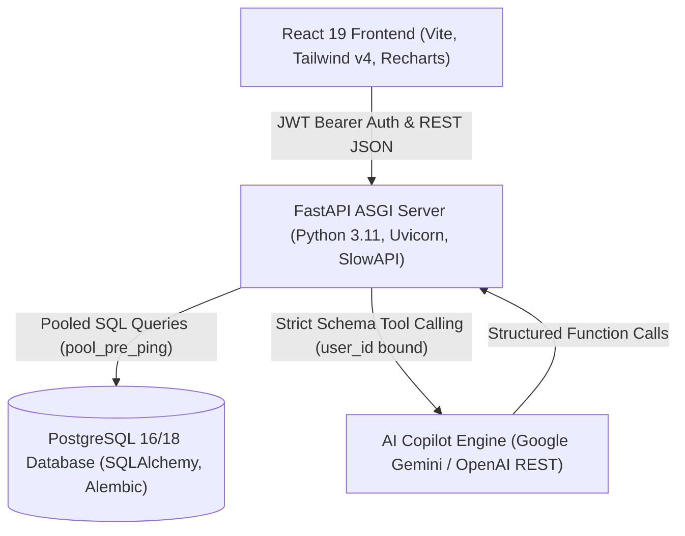
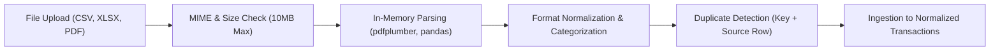
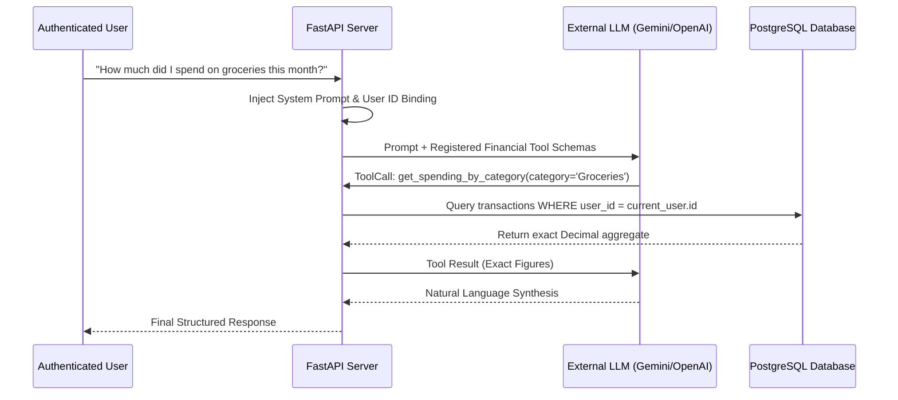

# PaisaClarity System Architecture

**Version**: 1.0.0 (Production Release Baseline)  
**Date**: 2026-11-12  

---

## 1. High-Level Architecture Overview

PaisaClarity is a privacy-first personal finance assistant engineered as a decoupled modern full-stack web application. It combines automated bank statement parsing, normalized ledger accounting, budget and savings analytics, and an authenticated AI Copilot with tool-calling capabilities.

---

## 2. Component Architecture

### A. Frontend Tier (React 19 + Vite 8)
- **Framework**: React 19 SPA with `react-router-dom` v7.
- **Styling**: Tailwind CSS v4 with unified design system (`navy`, `navy-light`, `mint`, `coral`).
- **Data Visualizations**: Recharts 3.x responsive charts with Indian Rupee (₹) currency formatting.
- **Security & State**:
  - Centralized API fetch wrapper in `frontend-react/src/api.js`.
  - JWT token storage in `localStorage` with automated 401 interception and logout redirection.
  - Route-level authentication barriers via `ProtectedRoute`.
- **Bundle Optimization**: Code splitting with dedicated vendor, charting, and application chunks (`< 400 kB` per chunk).

### B. Backend API Tier (FastAPI + Python 3.11)
- **Web Framework**: FastAPI with Pydantic v2 data models for input validation.
- **Application Server**: Uvicorn with multi-worker support, proxy headers handling, and liveness (`/health`) / readiness (`/health/ready`) probes.
- **Rate Limiting**: SlowAPI token-bucket rate limiter enforcing throttling on authentication and AI chat endpoints.
- **Error Handling**: Masked error responses to prevent leaking stack traces, table definitions, or database connection strings.

### C. Data Persistence Tier (PostgreSQL + SQLAlchemy 2.0 + Alembic)
- **Relational Schema**: 15 normalized tables with 81 covering indexes.
- **Precision Monetary Arithmetic**: Exact `Numeric(14, 2)` / Python `Decimal` across all transactions, budgets, goals, and balances.
- **Connection Management**: SQLAlchemy connection pool with pre-ping validation, automatic stale connection recycling (300s), and configurable pool limits.
- **Migration Engine**: Alembic with cross-compatible ANSI SQL boolean defaults (`true`/`false`).

---

## 3. Subsystem Architecture & Pipelines

### 1. Statement Ingestion Pipeline

- In-memory parsing ensures raw financial statements never touch physical server disk.
- Deduplication is guaranteed through composite source keys (`source_statement_id` + `source_row_index`) alongside heuristic transaction hashing (`date` + `normalized_description` + `amount`).

### 2. Transaction Normalization & Ledger
- Supports `debit` (expenses), `credit` (income), and `transfer` (inter-account movements).
- Inter-account transfers link paired transactions (`transfer_account_id`), ensuring internal movements never distort net spending or income analytics.

### 3. Budget & Savings Intelligence Engine
- **Monthly Budgets**: Computes real-time spending against category budgets and global thresholds with warning triggers.
- **Savings Goals**: Tracks target amounts, target dates, and accumulated contributions with negative balance protections.

### 4. Cash Flow & Recurring Payment Detection
- **Pattern Recognition**: Analyzes interval consistency (monthly, quarterly, annual) and merchant fuzzy matching to flag subscriptions and recurring obligations.
- **Anomaly Detection**: Surfaces statistical outliers based on historical spending distributions.

### 5. Secure AI Copilot Engine

- **Ownership Defense**: All tool executions strictly bind `user_id = current_user.id` on the server. The LLM cannot override or choose user context.
- **Deterministic Tools**: 12 registered tools calculate exact totals using Decimal arithmetic rather than relying on LLM math guesses.
- **Production Guard**: Strict prohibition against mock AI in production environments.

### 6. Reporting & Financial Exports
- **CSV & PDF Generation**: In-memory compilation of transaction registers and executive financial reports.
- **Security**: Strict formula injection sanitization (escapes `=`, `+`, `-`, `@` characters in spreadsheets) and user-scoped query boundaries.
