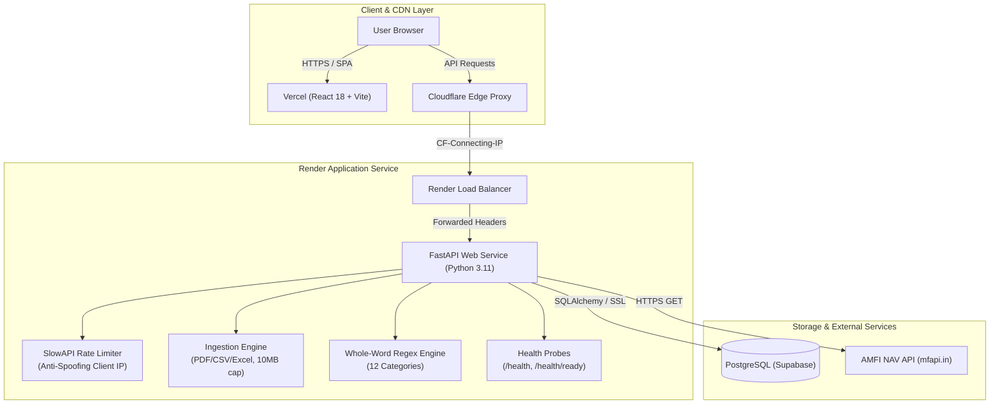

# PaisaClarity Development Progress & Status

This document tracks completed engineering phases, automated test metrics, architectural decisions, verified infrastructure, pending tasks, and known system limitations.

---

## 1. Summary of Completed Phases

| Phase | Branch | Status | Test Suite Result | Primary Deliverables |
|---|---|---|---|---|
| **Baseline Snapshot** | `master` | Merged / Baseline | **55 passed** | Clean snapshot of pre-existing working system; verified no `.env`, `.db`, or logs were tracked. |
| **Phase 1: Config Safety** | `phase-1-config-safety` | **Merged to master** | **65 passed** (+10 tests) | • Enforced strict production database checks & 3-attempt backoff retry. • Password masking in all logs and exception messages (`render_as_string(hide_password=True)`). • Rejected insecure or short (`<32` chars) `SECRET_KEY` in production. • Redirected SQLite fallback to pytest `tmp_path` in test environment. |
| **Phase 2: Categorizer Accuracy** | `phase-2-categorizer-fix` | **Merged to master** | **71 passed** (+6 tests) | • Replaced naive substring matching with regex whole-word boundary matching (`\b(keyword)\b`). • Eliminated false-positive classifications (e.g. `UPI/PVR` correctly mapped to Entertainment, `BARBEQUE NATION` to Food). • Preserved `normalize_description()`, deduplication keys (`transaction_key`), category order, and aliases. |
| **Phase 3A: Authentication Hardening** | `phase-3-auth-hardening` | **Merged to master** | **84 passed** (+13 tests) | • SlowAPI rate limiting on `/auth/login` (10/min) and `/auth/signup` (5/min). • Anti-spoofing client IP extractor (prioritizes unforgeable Cloudflare `CF-Connecting-IP`, ignores spoofed leftmost `X-Forwarded-For`). • Signup password policy ($\ge 8$ chars, not purely numeric, $\le 72$ bytes preventing native bcrypt 500 crashes). • Preserved CORS headers on HTTP 429 rate limit responses; kept login schema backward-compatible. |
| **Phase 7: Repo & Deploy Quality** | `phase-7-repo-quality` | **Merged to master** | **90 passed** (+6 tests) | • Additive health check probes: `GET /health` (liveness) and `GET /health/ready` (readiness with `SELECT 1`). • Gated runtime table creation behind `AUTO_CREATE_TABLES` (default `true` preserves current behavior). • Zero-drift verification between Alembic migrations and SQLAlchemy models. • Slim, non-root `Dockerfile`, `.dockerignore`, and local `docker-compose.yml`. • GitHub Actions CI pipeline (`backend` tests/coverage, `migrations` on PostgreSQL 16, `frontend` build). • Comprehensive root `README.md` and production transition guide `docs/migrations-plan.md`. |
| **Phase 5: Database Foundation** | `phase-5-database-foundation` | **Ready for Review** | **98 passed** (+8 tests) | • Normalized models: `FinancialAccount`, `Category`, `Transaction` with explicit foreign keys, indexes, and cascades. • Alembic migration `e8b1c4f2a9d0` with zero schema drift against SQLAlchemy models and reversible `downgrade()`. • Pre-seeded 17 standard system categories. • Explicit `Numeric(14, 2)` monetary handling with `ROUND_HALF_UP` quantization. • Repeatable, idempotent backfill pipeline (`backend/backfill.py`) using `(statement_id, source_row_index)` unique constraints. • Unreconciled placeholder accounts (`account_type="imported"`, `is_reconciled=False`) for historical unassigned statements. • Transfer grouping semantics (`transfer_group_id` UUID) and category deletion safety (`ON DELETE SET NULL`). |

---

## 2. Test Results & Quality Metrics

- **Backend Pytest Suite**: **98 passed, 3 warnings in ~54s** (100% pass rate).
  - `test_config_safety.py`: 10 tests passing
  - `test_categorizer_accuracy.py`: 6 tests passing
  - `test_auth_hardening.py`: 13 tests passing
  - `test_repo_quality.py`: 6 tests passing
  - `test_database_foundation.py`: 8 tests passing
  - Existing functional tests (`test_auth.py`, `test_ingest.py`, `test_insights.py`, etc.): 55 tests passing
- **Frontend Production Build**: `npm run build` completed successfully (`vite build` $\rightarrow$ `dist/` compiled in ~2.1s).
- **Alembic Schema Drift Check**: Ran all 5 migration revisions (`e8b1c4f2a9d0`) against a fresh disposable database; compared with `Base.metadata`. **Zero schema drift detected** (`diff: []`). Downgrade and re-upgrade verified cleanly.

---

## 3. Verified Architecture & Components

---

## 4. Pending Work & Future Phases

1. **Phase 5 Merge & Production Migration**:
   - Merge `phase-5-database-foundation` into `master` upon user approval.
   - Run `alembic upgrade head` and execute initial idempotent backfill against production PostgreSQL during scheduled maintenance.
2. **Phase 6: Transaction Management API & UI**:
   - Build RESTful endpoints for CRUD operations on normalized `Transaction`, `FinancialAccount`, and `Category` entities.
   - Automatic live ingestion: when users upload a statement, populate normalized `transactions` immediately alongside `Statement.result`.
   - Reconcile placeholder accounts (`account_type="imported"`) by linking to actual user-created bank/credit card accounts.
3. **Phase 3B: Refresh Tokens & Session Management (Deferred)**:
   - Evaluated cross-domain cookie approaches. Deferred because proxying through Vercel would mask client IPs behind Vercel edge IPs unless custom forwarding headers are parsed.
4. **Frontend Lint Cleanup**:
   - `frontend-react` currently has 2 pre-existing ESLint warnings in `App.jsx` (`Navigate` unused) and `Dashboard.jsx` (direct `setState` inside `useEffect`). In CI, `npm run lint` is marked `continue-on-error: true` so builds succeed without violating the rule against modifying `frontend-react/src`. These will be cleaned up in a dedicated frontend phase.
5. **Repository Remote & Live Sync**:
   - Local workspace is not currently linked to a remote. Once approved, add the remote (`git remote add origin <url>`) and push `master` to trigger GitHub Actions CI.
6. **README Placeholders**:
   - Fill in live deployment URLs (Vercel and Render) and add application screenshots to `docs/images/`.

---

## 5. Known Limitations & Constraints

- **Historical Statement Normalization**: Historical transactions are maintained in both normalized `transactions` table (via `backend/backfill.py`) and legacy `Statement.result` JSON blobs for complete backwards compatibility.
- **Unassigned Historical Accounts**: Statements uploaded before Phase 5 are mapped to an unreconciled placeholder account (`account_type="imported"`, `is_reconciled=False`) until explicitly assigned by the user.
- **In-Memory Rate Limiting**: SlowAPI tracks login and signup hit counters in process memory. Counters reset on dyno restarts. For multi-instance scaling, a Redis backend (`storage_uri="redis://..."`) is recommended.
- **Rule-Based Categorization**: Uses keyword stem dictionaries with whole-word boundary matching rather than machine learning or NLP; unknown merchants fall back to `Other`.
- **JWT Lifespan**: Access tokens expire after 24 hours without silent refresh, requiring re-login upon expiration.
- **Free-Tier Cold Starts**: On Render's free tier, the backend web service spins down after inactivity, causing a 30–50 second delay on initial boot.
