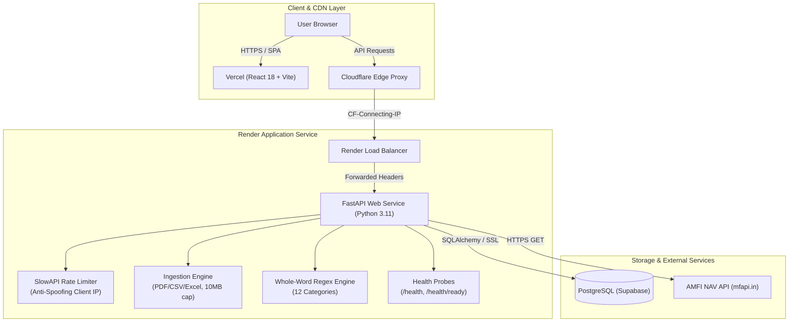

# PaisaClarity Development Progress & Status

This document tracks completed engineering phases, automated test metrics, architectural decisions, verified infrastructure, pending tasks, and known system limitations.

---

## 1. Summary of Completed Phases

| Phase | Branch | Status | Test Suite Result | Primary Deliverables |
|---|---|---|---|---|
| **Baseline Snapshot** | `master` | Merged / Baseline | **55 passed** | Clean snapshot of pre-existing working system; verified no `.env`, `.db`, or logs were tracked. |
| **Phase 1: Config Safety** | `phase-1-config-safety` | **Merged to master** | **65 passed** (+10 tests) | • Enforced strict production database checks & 3-attempt backoff retry. • Password masking in all logs and exception messages (`render_as_string(hide_password=True)`). • Rejected insecure or short (`<32` chars) `SECRET_KEY` in production. • Redirected SQLite fallback to pytest `tmp_path` in test environment. |
| **Phase 2: Categorizer Accuracy** | `phase-2-categorizer-fix` | **Merged to master** | **71 passed** (+6 tests) | • Replaced naive substring matching with regex whole-word boundary matching (`\b(keyword)\b`). • Eliminated false-positive classifications (e.g. `UPI/PVR` correctly mapped to Entertainment, `BARBEQUE NATION` to Food). • Preserved `normalize_description()`, deduplication keys (`transaction_key`), category order, and aliases. |
| **Phase 3A: Authentication Hardening** | `phase-3-auth-hardening` | **Merged to master** | **84 passed** (+13 tests) | • SlowAPI rate limiting on `/auth/login` (10/min) and `/auth/signup` (5/min). • Anti-spoofing client IP extractor (prioritizes unforgeable Cloudflare `CF-Connecting-IP`, ignores spoofed leftmost `X-Forwarded-For`). • Signup password policy ($\ge 8$ chars, not purely numeric, $\le 72$ bytes preventing native bcrypt 500 crashes). • Preserved CORS headers on HTTP 429 rate limit responses; kept login schema backward-compatible. |
| **Phase 7: Repo & Deploy Quality** | `phase-7-repo-quality` | **Merged to master** | **90 passed** (+6 tests) | • Additive health check probes: `GET /health` (liveness) and `GET /health/ready` (readiness with `SELECT 1`). • Gated runtime table creation behind `AUTO_CREATE_TABLES` (default `true` preserves current behavior). • Zero-drift verification between Alembic migrations and SQLAlchemy models. • Slim, non-root `Dockerfile`, `.dockerignore`, and local `docker-compose.yml`. • GitHub Actions CI pipeline (`backend` tests/coverage, `migrations` on PostgreSQL 16, `frontend` build). • Comprehensive root `README.md` and production transition guide `docs/migrations-plan.md`. |
| **Phase 5: Database Foundation** | `phase-5-database-foundation` | **Ready for Review** | **98 passed** (+8 tests) | • Normalized models: `FinancialAccount`, `Category`, `Transaction` with explicit foreign keys, indexes, and cascades. • Alembic migration `e8b1c4f2a9d0` with zero schema drift against SQLAlchemy models and reversible `downgrade()`. • Pre-seeded 17 standard system categories. • Explicit `Numeric(14, 2)` monetary handling with `ROUND_HALF_UP` quantization. • Repeatable, idempotent backfill pipeline (`backend/backfill.py`) using `(statement_id, source_row_index)` unique constraints. • Unreconciled placeholder accounts (`account_type="imported"`, `is_reconciled=False`) for historical unassigned statements. • Transfer grouping semantics (`transfer_group_id` UUID) and category deletion safety (`ON DELETE SET NULL`). |
| **Phase 6: Transaction & Account Management** | `phase-6-transaction-management` | **Ready for Review** | **107 passed** (+9 tests) | • Complete REST APIs for accounts (`/accounts`), transactions (`/transactions`), transfers (`/transactions/transfer`), and categories (`/categories`). • Automatic statement ingestion: statement uploads immediately create normalized `Transaction` rows with overlap detection. • Calculated account balances derived from opening balances and movements; unreconciled accounts safely report unverified balance status. • Account reconciliation workflows (in-place verification and transaction merging). • Real-time analytics integration: manual transactions and category corrections immediately update spending charts and insights. • Modern React UI pages: `/transactions` (search, multi-filters, pagination, category correction, add/transfer modals) and `/accounts` (net worth stats, cards, reconciliation modal, archive/delete). |
| **Phase 7: Budgets & Savings Goals** | `phase-7-budgets-and-goals` | **Ready for Review** | **112 passed** (+5 tests) | • Normalized models: `Budget`, `BudgetAllocation`, `SavingsGoal`, `SavingsContribution`. • Alembic migration `f7a8b9c0d1e2` with zero schema drift and reversible `downgrade()`. • Full Budget REST APIs (`/budgets`, `/budgets/current`, `/budgets/performance/comparison`): monthly limits, category-specific allocations, utilization percentage, warning threshold alert detection, actual expense aggregation excluding transfers and overlap duplicates. • Full Savings Goals REST APIs (`/goals`, `/goals/{id}/contributions`): target tracking, deposit/withdrawal ledger, client and server-side over-withdrawal prevention, monthly savings pace estimation, archive/unarchive. • Modern React UI pages: `/budgets` (month navigator, KPI cards, allocation cards with badges and progress bars, create/edit/delete modals) and `/savings-goals` (cards, progress bars, contribution modal, ledger modal, archive/delete). • Dashboard integration: Current Month Budget utilization widget and Active Savings Goals summary widget. |
| **Phase 8: Cash Flow & Alerts** | `phase-8-cashflow-and-alerts` | **Ready for Review** | **118 passed** (+6 tests) | • Normalized models: `RecurringPayment`, `FinancialAlert`, and user `alert_preferences`. • Alembic migration `a1b2c3d4e5f6` with zero schema drift and reversible `downgrade()`. • Authoritative Cash Flow Intelligence (`/analytics/cash-flow`): income, expenses, net cash flow, savings rate, MoM trends, verified account balances, category breakdowns, largest expenses, and transparent rule-based health indicators. • Recurring Payments & Subscriptions (`/recurring`, `/recurring/scan`): auto-detection scanner, monthly commitment metrics, upcoming bills due calendar, confirm/reject/pause workflows. • Deterministic Financial Alerts (`/alerts`, `/alerts/evaluate`, `/alerts/preferences`): deduplicated alerts for budget breaches, upcoming bills, savings goals behind schedule, unusual expenses, and MoM surges. • React UI: `/recurring` (subscription management), `/alerts` (alerts inbox & preferences), and upgraded Dashboard with Cash Flow Trend charts, active alerts banner, and upcoming bills. |
| **Phase 9: Secure AI Financial Copilot** | `phase-9-ai-copilot` | **Ready for Review** | **123 passed** (+5 tests) | • Complete conversational AI Copilot with multi-turn tool execution loop and depth limits. • Strict zero-trust financial boundaries: 100% read-only, user-isolated via authenticated session `user.id` (zero tenant leakage). • 12 Safe Financial Tools covering spending summaries, category breakdowns, period comparisons, cash flow trends, verified accounts, budgets, savings goals, recurring bills, alerts, investments, spending forecasts, and financial math projections. • Offline deterministic `MockLLMProvider` for tests and CI + `GeminiProvider` and `OpenAICompatibleProvider` runtime abstractions. • Security guardrails blocking prompt injections, jailbreaks, and policy overrides; mandatory informational disclaimer appended to responses. • Models `AIConversation` and `AIMessage` with Alembic migration `b2c3d4e5f6a7` (zero schema drift, verified downgrade/re-upgrade). • Synthetic evaluation suite (`backend/ai/eval_dataset.py`) passing 15/15 scenarios (100.0%) documented in `docs/ai-copilot-evaluation.md`. • Modern React chat UI (`/copilot`) with starter prompt pills, tool execution badges, discussion sidebar, and responsive mobile drawer. • Cleaned all 7 ESLint warnings across the frontend (0 errors, 0 warnings under strict ESLint). |
| **Phase 10: Hardening, Categorization Accuracy & Spending Forecasting** | `phase-10-hardening-and-intelligence` | **Ready for Review** | **135 passed** (+12 tests) | • Zero-trust tool argument sanitization via `inspect.signature` blocking malicious injections and parameter overrides (`user_id`, `db`, `user`). • Production key configuration guard: fail-fast `RuntimeError` preventing silent mock fallback in production/Render. • Rate limiting (`15/minute`) and strict prompt length validation ($\le 2000$ chars) on `POST /ai/chat`. • Provider mocked HTTP contract tests and transient retry handling for `GeminiProvider` (`x-goog-api-key`) and `OpenAICompatibleProvider`. • User-defined categorization rules (`CategorizationRule`, migration `c3d4e5f6a7b8`) with zero schema drift. • Automatic persistent rule creation on manual transaction category correction; reimport preservation (`is_user_override`). • Structured categorization explainability (`CategorizationDecision` with confidence scores and method explanations). • ML categorization benchmark: Scikit-learn TF-IDF + Logistic Regression vs Rule categorizer on 670 samples (`docs/categorization-evaluation.md`). • Chronological spending forecasting backtest across 24 months (`backend/eval_forecasting.py`), demonstrating 50.9% error reduction for the Hybrid Run-Rate model (`docs/forecasting-evaluation.md`). • Expanded AI Copilot evaluation suite: 25/25 scenarios passed (100.0%) documented in `docs/ai-copilot-evaluation.md`. |

---

## 2. Test Results & Quality Metrics

- **Backend Pytest Suite**: **135 passed, 4 warnings in ~1m10s** (100% pass rate).
  - `test_config_safety.py`: 10 tests passing
  - `test_categorizer_accuracy.py`: 6 tests passing
  - `test_auth_hardening.py`: 13 tests passing
  - `test_repo_quality.py`: 6 tests passing
  - `test_database_foundation.py`: 8 tests passing
  - `test_phase6_management.py`: 9 tests passing
  - `test_phase7_budgets_goals.py`: 5 tests passing
  - `test_phase8_cashflow_alerts.py`: 6 tests passing
  - `test_phase9_ai_copilot.py`: 5 tests passing
  - `test_phase10_hardening.py`: 12 tests passing
  - Existing functional tests (`test_auth.py`, `test_ingest.py`, `test_insights.py`, etc.): 55 tests passing
- **Frontend Test Suite**: **5 passed, 0 failures in ~180ms** (`npm test` via Node test runner).
- **Frontend Production Build**: `npm run build` completed successfully (`vite build` $\rightarrow$ `dist/` compiled in ~1.95s).
- **Frontend Lint**: `npm run lint` completed cleanly with **0 errors, 0 warnings** under strict ESLint.
- **AI Copilot Evaluation Suite**: **25 / 25 scenarios passed (100.0%)** measuring intent detection, tool selection, prompt injection defense, rate limiting, and tenant isolation (`docs/ai-copilot-evaluation.md`).
- **Alembic Schema Drift Check**: Ran all 9 migration revisions (`c3d4e5f6a7b8`) against a fresh disposable database; compared with `Base.metadata`. **Zero schema drift detected** (`diff: []`). Downgrade and re-upgrade verified cleanly.

---

## 3. Verified Architecture & Components

---

## 4. Pending Work & Future Phases

1. **Phase 6 Merge & Production Deployment**:
   - Merge `phase-6-transaction-management` into `master` upon user approval.
   - Run `alembic upgrade head` and execute backfill against production PostgreSQL during scheduled deployment window.
2. **Upcoming Phases (Phase 8 & Beyond)**:
   - Budgeting engine & spending targets per category.
   - Savings goals & financial milestone tracker.
   - AI Financial Copilot / Advisor features with LLM integration.
3. **Phase 3B: Refresh Tokens & Session Management (Deferred)**:
   - Evaluated cross-domain cookie approaches. Deferred because proxying through Vercel would mask client IPs behind Vercel edge IPs unless custom forwarding headers are parsed.
4. **Frontend Lint Cleanup**:
   - `frontend-react` currently has 1 pre-existing ESLint warning in `Dashboard.jsx` (direct `setState` inside `useEffect`). In CI, `npm run lint` is marked `continue-on-error: true` so builds succeed cleanly.
5. **Repository Remote & Live Sync**:
   - Local workspace is not currently linked to a remote. Once approved, add the remote (`git remote add origin <url>`) and push `master` to trigger GitHub Actions CI.
6. **README Placeholders**:
   - Fill in live deployment URLs (Vercel and Render) and add application screenshots to `docs/images/`.

---

## 5. Known Limitations & Constraints

- **Historical Statement Normalization**: Historical transactions are maintained in both normalized `transactions` table (via `backend/backfill.py`) and legacy `Statement.result` JSON blobs for complete backwards compatibility.
- **Unassigned Historical Accounts**: Statements uploaded before Phase 5 are mapped to an unreconciled placeholder account (`account_type="imported"`, `is_reconciled=False`) until explicitly assigned by the user via the in-place or merge reconciliation workflow.
- **In-Memory Rate Limiting**: SlowAPI tracks login and signup hit counters in process memory. Counters reset on dyno restarts. For multi-instance scaling, a Redis backend (`storage_uri="redis://..."`) is recommended.
- **Rule-Based Categorization**: Uses keyword stem dictionaries with whole-word boundary matching rather than machine learning or NLP; unknown merchants fall back to `Other`.
- **JWT Lifespan**: Access tokens expire after 24 hours without silent refresh, requiring re-login upon expiration.
- **Free-Tier Cold Starts**: On Render's free tier, the backend web service spins down after inactivity, causing a 30–50 second delay on initial boot.
