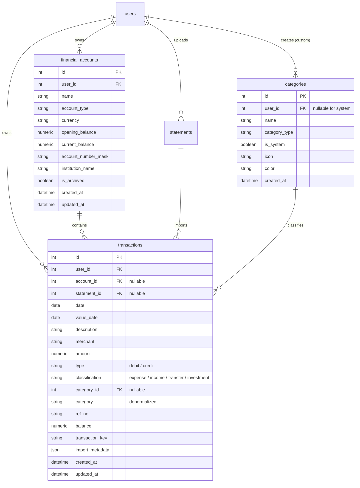

# Database Foundation Architecture & Migration Plan
## Normalized Accounts, Categories, and Transactions

This document details the architectural design, schema definitions, Alembic migration strategy, idempotent backfill pipeline, compatibility safeguards, and open design decisions for transitioning PaisaClarity from JSON-blob statement storage to a fully normalized database foundation.

---

## 1. Architectural Motivation & Existing State

### Current State
- `statements` table stores the entire parsing output, ingest metadata, and canonical transaction list as a single JSON blob (`Statement.result["transactions"]`).
- Multi-statement analytics (`transactions.py`) parses and merges JSON dicts on the fly in Python/Pandas at query time.
- **Limitations**:
  - No database-level querying, indexing, or filtering across individual transactions (e.g. date range, category, merchant).
  - Transactions cannot be edited, re-categorized, split, or manually added without mutating the raw statement JSON.
  - No concept of distinct financial accounts (Savings Account, Credit Card, Demat, Cash Wallet).

### Target State
- Dedicated, normalized tables: `financial_accounts`, `categories`, and `transactions`.
- Full referential integrity, indexes on query paths, and multi-tenant user isolation.
- Preservation of existing `statements.result` JSON blobs for historical reconciliation and zero data loss.
- High-precision monetary storage using `Numeric(14, 2)` (SQLAlchemy `Numeric` / Python `Decimal`).
- An idempotent, repeatable backfill migration that extracts historical transactions from existing statements into normalized rows.

---

## 2. Proposed Database Schema



---

## 3. Detailed Model Specifications

### 3.1 FinancialAccount (`financial_accounts`)

Represents a real-world financial container (bank account, credit card, wallet, etc.).

| Column | Type | Nullable | Default | Description |
|---|---|---|---|---|
| `id` | `Integer` | No | Auto-inc | Primary key |
| `user_id` | `Integer` | No | - | Foreign key to `users.id` (`ON DELETE CASCADE`), indexed |
| `name` | `String(100)` | No | - | e.g. "HDFC Salary Account", "SBI Cashback Credit Card" |
| `account_type` | `String(50)` | No | - | `savings`, `current`, `credit_card`, `investment`, `wallet`, `loan`, `other` |
| `currency` | `String(3)` | No | `'INR'` | ISO 4217 currency code |
| `opening_balance` | `Numeric(14, 2)` | No | `0.00` | Initial balance before imported transactions |
| `current_balance` | `Numeric(14, 2)` | Yes | `NULL` | Cached running balance for fast dashboard display |
| `account_number_mask` | `String(20)` | Yes | `NULL` | Masked identifier for UI reconciliation (e.g. `XX5678`) |
| `institution_name` | `String(100)` | Yes | `NULL` | e.g. "HDFC Bank", "ICICI Bank" |
| `is_archived` | `Boolean` | No | `False` | Soft-archiving flag to hide closed accounts, indexed |
| `created_at` | `DateTime(timezone=True)` | No | `now()` | Audit creation timestamp |
| `updated_at` | `DateTime(timezone=True)` | No | `now()` | Auto-updating modification timestamp |

**Indexes & Constraints**:
- `Index("ix_financial_accounts_user_id", "user_id")`
- `Index("ix_financial_accounts_is_archived", "is_archived")`
- `UniqueConstraint("user_id", "name", name="uq_financial_accounts_user_name")`: Prevents duplicate account names per user.

---

### 3.2 Category (`categories`)

Supports global system defaults alongside user-defined custom categories.

| Column | Type | Nullable | Default | Description |
|---|---|---|---|---|
| `id` | `Integer` | No | Auto-inc | Primary key |
| `user_id` | `Integer` | **Yes** | `NULL` | Foreign key to `users.id` (`ON DELETE CASCADE`). `NULL` denotes global system category. |
| `name` | `String(100)` | No | - | Category label (e.g. "Food", "Groceries", "Custom Travel") |
| `category_type` | `String(50)` | No | `'expense'` | `expense`, `income`, `transfer`, `investment` |
| `is_system` | `Boolean` | No | `False` | `True` for system-provided defaults, `False` for user custom |
| `icon` | `String(50)` | Yes | `NULL` | UI Lucide icon token (e.g. `utensils`, `shopping-cart`) |
| `color` | `String(20)` | Yes | `NULL` | Hex color code for charts and badges (e.g. `#10B981`) |
| `created_at` | `DateTime(timezone=True)` | No | `now()` | Audit timestamp |

**Indexes & Constraints**:
- `Index("ix_categories_user_id", "user_id")`
- `Index("ix_categories_is_system", "is_system")`
- Composite partial unique indexing or standard constraint:
  - System categories: `name` is unique where `user_id IS NULL`.
  - User categories: `(user_id, name)` is unique where `user_id IS NOT NULL`.

**Seed Categories** (17 standard system categories matching `categorizer.py`):
- **Income**: `Income`
- **Investments**: `Investments`
- **Transfers**: `Transfers`
- **Expenses**: `Rent`, `EMI & Loans`, `Insurance`, `Cash Withdrawal`, `Food`, `Groceries`, `Shopping`, `Transport`, `Travel`, `Bills`, `Entertainment`, `Health`, `Education`, `Other`

---

### 3.3 Transaction (`transactions`)

The core normalized ledger record for every monetary movement.

| Column | Type | Nullable | Default | Description |
|---|---|---|---|---|
| `id` | `Integer` | No | Auto-inc | Primary key |
| `user_id` | `Integer` | No | - | Foreign key to `users.id` (`ON DELETE CASCADE`), indexed |
| `account_id` | `Integer` | **Yes** | `NULL` | Foreign key to `financial_accounts.id` (`ON DELETE SET NULL`), indexed |
| `statement_id` | `Integer` | **Yes** | `NULL` | Foreign key to `statements.id` (`ON DELETE SET NULL`), indexed |
| `date` | `Date` | No | - | Effective transaction date (from statement), indexed |
| `value_date` | `Date` | Yes | `NULL` | Bank settlement / posting date |
| `description` | `String(500)` | No | - | Original bank narration text |
| `merchant` | `String(200)` | Yes | `NULL` | Extracted / normalized merchant name |
| `amount` | `Numeric(14, 2)` | No | - | Strictly positive transaction magnitude |
| `type` | `String(10)` | No | - | Ingestion contract: `'debit'` or `'credit'` |
| `classification` | `String(20)` | No | - | Financial classification: `'expense'`, `'income'`, `'transfer'`, `'investment'` |
| `category_id` | `Integer` | Yes | `NULL` | Foreign key to `categories.id` (`ON DELETE SET NULL`), indexed |
| `category` | `String(100)` | No | `'Other'` | Denormalized category string for high-speed reporting |
| `ref_no` | `String(100)` | Yes | `NULL` | Reference number / UTR / cheque number, indexed |
| `balance` | `Numeric(14, 2)` | Yes | `NULL` | Post-transaction statement running balance |
| `transaction_key` | `String(255)` | No | - | Deduplication hash key: `date_amount_normalized_desc` |
| `import_metadata` | `JSON` | Yes | `NULL` | Debug metadata: line number, source sheet, raw row |
| `created_at` | `DateTime(timezone=True)` | No | `now()` | Row creation timestamp |
| `updated_at` | `DateTime(timezone=True)` | No | `now()` | Row update timestamp |

**Indexes**:
- `Index("ix_transactions_user_date", "user_id", "date")`: Core query path for time-series charts, monthly spend, and dashboards.
- `Index("ix_transactions_user_account", "user_id", "account_id")`: Account filtering and reconciliation.
- `Index("ix_transactions_user_category", "user_id", "category_id")`: Category analytics and budget tracking.
- `Index("ix_transactions_user_key", "user_id", "transaction_key")`: Cross-statement duplicate detection lookup.
- `Index("ix_transactions_ref_no", "ref_no")`: Fast reference lookup.

---

## 4. Alembic Migration Strategy

1. **New Migration Script**: `add_accounts_categories_and_transactions.py`
   - Depends on `c3f9a1d2b7e4` (current head).
   - `upgrade()`:
     1. Creates `financial_accounts` table and indexes.
     2. Creates `categories` table and indexes.
     3. Seeds the 17 standard system categories into `categories`.
     4. Creates `transactions` table, foreign keys, and compound indexes.
   - `downgrade()`:
     1. Drops `transactions`.
     2. Drops `categories`.
     3. Drops `financial_accounts`.
2. **Reversibility**:
   - Downgrade cleanly drops the new tables without modifying `users`, `statements`, or `investments`.
   - Existing `statements.result` data remains completely intact and untouched.

---

## 5. Repeatable & Idempotent Backfill Pipeline

### Requirements
- Process all existing `Statement` records ordered by `uploaded_at ASC`.
- Migrate transactions stored in `Statement.result["transactions"]` into the `transactions` table.
- Guarantee **zero duplicate creation** if executed multiple times.
- Maintain accurate transaction linkages and audit trails.

### Backfill Algorithm
```python
def backfill_statement_transactions(db: Session, user_id: int | None = None) -> BackfillResult:
    """
    Idempotent migration: extracts transactions from Statement.result["transactions"]
    into normalized `transactions` table rows.
    """
    # 1. Fetch statements (optionally filtered by user)
    statements = db.query(Statement).order_by(Statement.uploaded_at.asc()).all()

    # 2. Pre-cache existing system categories map: {name.lower(): id}
    categories_map = {c.name.lower(): c.id for c in db.query(Category).all()}
    
    # 3. For each user, ensure an "Imported Statements" default account exists
    #    (or leave account_id=NULL depending on decision below)
    
    rows_inserted = 0
    rows_skipped_duplicate = 0
    statements_processed = 0

    for stmt in statements:
        raw_txs = (stmt.result or {}).get("transactions") or []
        if not raw_txs:
            continue

        statements_processed += 1
        
        # Check existing transactions already linked to this statement
        existing_keys = {
            t.transaction_key for t in db.query(Transaction.transaction_key)
            .filter(Transaction.statement_id == stmt.id).all()
        }

        for idx, row in enumerate(raw_txs):
            key = compute_transaction_key(row["date"], row["description"], row["amount"])
            
            # Idempotency check: if transaction already backfilled from this statement, skip
            if key in existing_keys:
                rows_skipped_duplicate += 1
                continue

            # Resolve category and classification
            cat_name = row.get("category") or categorize_narration(row["description"])
            cat_id = categories_map.get(cat_name.lower())
            classification = resolve_classification(row["type"], cat_name)

            new_tx = Transaction(
                user_id=stmt.user_id,
                statement_id=stmt.id,
                account_id=default_account_id,
                date=parse_date(row["date"]),
                value_date=parse_date(row.get("value_date")),
                description=str(row["description"]),
                merchant=normalize_description(row["description"]),
                amount=Decimal(str(row["amount"])),
                type=str(row["type"]).lower(),
                classification=classification,
                category_id=cat_id,
                category=cat_name,
                ref_no=row.get("ref_no"),
                balance=Decimal(str(row["balance"])) if row.get("balance") is not None else None,
                transaction_key=key,
                import_metadata={"statement_row_index": idx, "filename": stmt.filename},
            )
            db.add(new_tx)
            existing_keys.add(key)
            rows_inserted += 1

        db.commit()

    return BackfillResult(statements=statements_processed, inserted=rows_inserted, skipped=rows_skipped_duplicate)
```

---

## 6. Compatibility & Safeguards

1. **Zero Data Loss**:
   - `Statement.result` remains populated and functional. Existing endpoints (`/statements`, `/statements/{id}`, `/insights`) continue to function without interruption.
2. **Backward-Compatible Dual Operation**:
   - The ingestion pipeline will write to both `Statement.result` and the new normalized `transactions` table.
   - Analytics services (`insights.py`) can consume from either Pandas DataFrames or direct SQLAlchemy queries.
3. **Decimal Precision**:
   - Ingest float representations are explicitly cast via `Decimal(str(round(amount, 2)))` to prevent floating-point rounding anomalies.
4. **Multi-Tenant Security**:
   - Every table includes `user_id` with foreign key constraints. All queries strictly filter by `user_id == current_user.id` to prevent IDOR and cross-user data leakage.

---

## 7. Open Design Decisions for User Approval

### Decision 1: `account_id` Handling for Historical Statements
When backfilling statements uploaded in the past, no `financial_account` was specified by the user.
- **Option A (Nullable Foreign Key)**: Leave `account_id = NULL` on historical transactions.
  - *Pros*: Completely honest about historical data where no account was chosen.
  - *Cons*: Queries grouping by account will have an `Unassigned` bucket.
- **Option B (Auto-create "Primary Account" per user)**: During backfill, automatically create a default `FinancialAccount(name="Primary Account", account_type="savings")` for any user with statements and link transactions to it.
  - *Pros*: Every transaction belongs to an account; clean balances and reports.
  - *Cons*: Makes an assumption about the account type and name.
- **Recommendation**: **Hybrid**. Make `account_id` **nullable in the schema** (maximum flexibility), but have the backfill script create an `Imported Statements` default account per user so existing data immediately organizes cleanly while allowing users to rename or reassign accounts later.

### Decision 2: Category Relationship & Denormalization
- **Option A (Strict Normalization)**: Store only `category_id` (foreign key to `categories.id`).
  - *Pros*: Pure relational design.
  - *Cons*: Every query, chart, and export requires a `JOIN categories` or extra loading. If a user deletes a custom category, the historical transaction loses its category string unless handled carefully.
- **Option B (Dual Storage: `category_id` + denormalized `category` string)**:
  - *Pros*: Ultra-fast queries; matches existing code contract (`df["category"]`); preserves historical category name if a custom category is deleted or renamed.
  - *Cons*: Slight redundancy.
- **Recommendation**: **Option B**. Storing both `category_id` and `category` (String) delivers optimal read performance, rock-solid stability, and seamless compatibility with existing analytics modules.

### Decision 3: Transaction Classification vs Type
Existing codebase uses `type: "debit" | "credit"`.
- *Recommendation*: Store `type` (`"debit"` | `"credit"`) for ingestion contract parity, AND add `classification` (`"expense"`, `"income"`, `"transfer"`, `"investment"`) derived from `type` and `NON_SPENDING_CATEGORIES`. This provides immediate clarity for budget and cash-flow reporting.

---

## 8. Verification & Testing Strategy

Before touching any production service:
1. **Empty Database Migration**: Run `alembic upgrade head` on an empty SQLite/PostgreSQL test database. Verify tables and indexes are created cleanly.
2. **Populated Database Migration**: Seed an existing SQLite database with users, statements containing JSON transactions, and investments. Run migration and verify existing data remains untouched.
3. **Backfill Verification**: Run the backfill script. Verify transaction count matches statement transactions.
4. **Idempotency Test**: Run the backfill script a second time immediately. Verify: `0 rows inserted`, `0 duplicates created`, all counts identical.
5. **Rollback Test**: Run `alembic downgrade -1`. Verify new tables drop cleanly and original tables remain intact.
6. **Pytest Regression**: Full test suite must continue to pass 100%.

---

*This plan is prepared and waiting for your review. Please confirm if you approve the schema, migration strategy, and recommended decisions so implementation can proceed.*
