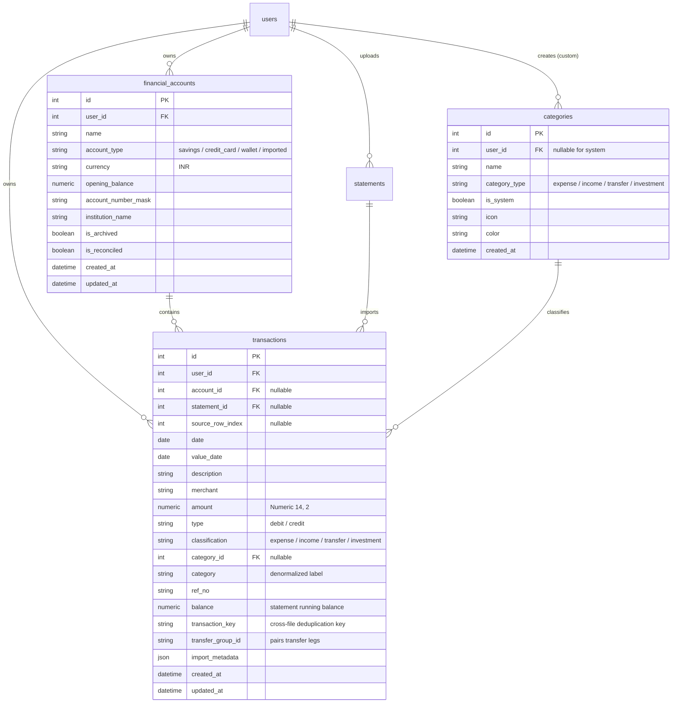

# Database Foundation Architecture & Migration Plan
## Normalized Accounts, Categories, and Transactions

This document details the architectural design, schema definitions, Alembic migration strategy, idempotent backfill pipeline, compatibility safeguards, and operational rules for transitioning PaisaClarity from JSON-blob statement storage to a fully normalized database foundation.

---

## 1. Architectural Motivation & Existing State

### Current State
- `statements` table stores the entire parsing output, ingest metadata, and canonical transaction list as a single JSON blob (`Statement.result["transactions"]`).
- Multi-statement analytics (`transactions.py`) merges JSON dicts dynamically in Python/Pandas at query time.
- **Limitations**:
  - No database-level indexing, filtering, or aggregations across individual transactions.
  - Transactions cannot be edited, re-categorized, split, or reconciled without mutating raw statement JSON.
  - No representation of distinct financial containers (Savings, Checking, Credit Cards, Wallets).

### Target State
- Normalized relational tables: `financial_accounts`, `categories`, and `transactions`.
- Full referential integrity, indexes on query paths, and strict multi-tenant user isolation.
- Continuous preservation of `statements.result` JSON blobs for historical reconciliation and zero data loss.
- High-precision monetary storage using `Numeric(14, 2)` (SQLAlchemy `Numeric` / Python `Decimal`) with explicit quantization.
- A repeatable, idempotent backfill process to migrate transactions from existing statement JSON into normalized rows without duplicate creation or loss of identical legitimate transactions.

---

## 2. Updated Database Schema Diagram



---

## 3. Detailed Model Specifications

### 3.1 FinancialAccount (`financial_accounts`)

Represents a real-world financial container (bank account, credit card, wallet, etc.).

| Column | Type | Nullable | Default | Description |
|---|---|---|---|---|
| `id` | `Integer` | No | Auto-inc | Primary key |
| `user_id` | `Integer` | No | - | Foreign key to `users.id` (`ON DELETE CASCADE`), indexed |
| `name` | `String(100)` | No | - | Account name (e.g. "HDFC Salary", "Imported Statements") |
| `account_type` | `String(50)` | No | - | `savings`, `current`, `credit_card`, `investment`, `wallet`, `loan`, `imported` |
| `currency` | `String(3)` | No | `'INR'` | ISO 4217 currency code |
| `opening_balance` | `Numeric(14, 2)` | No | `0.00` | Initial baseline balance |
| `account_number_mask` | `String(20)` | Yes | `NULL` | Masked identifier for UI reconciliation (e.g. `XX5678`) |
| `institution_name` | `String(100)` | Yes | `NULL` | e.g. "HDFC Bank", "ICICI Bank" |
| `is_archived` | `Boolean` | No | `False` | Soft-archiving flag to hide closed accounts, indexed |
| `is_reconciled` | `Boolean` | No | `True` | Set to `False` for placeholder/imported accounts to exclude from verified net worth |
| `created_at` | `DateTime(timezone=True)` | No | `now()` | Audit creation timestamp |
| `updated_at` | `DateTime(timezone=True)` | No | `now()` | Auto-updating modification timestamp |

**Design Rule on Balances & Net Worth**:
- **No independently mutable `current_balance` column**: Avoids cache-invalidation bugs and out-of-sync mutations. Verified account balance is calculated dynamically:
  $$\text{Verified Balance} = \text{opening\_balance} + \sum \text{Credits} - \sum \text{Debits}$$
- **Historical imported placeholder accounts**: Given `account_type="imported"` and `is_reconciled=False`. Excluded from verified net worth and balance cards until the user links them to a real account.

**Constraints**:
- `UniqueConstraint("user_id", "name", name="uq_financial_accounts_user_name")`: Prevents duplicate account names per user.

---

### 3.2 Category (`categories`)

Supports global system defaults alongside user-defined custom categories.

| Column | Type | Nullable | Default | Description |
|---|---|---|---|---|
| `id` | `Integer` | No | Auto-inc | Primary key |
| `user_id` | `Integer` | **Yes** | `NULL` | Foreign key to `users.id` (`ON DELETE CASCADE`). `NULL` denotes global system category. |
| `name` | `String(100)` | No | - | Category label (e.g. "Food", "Groceries", "Custom Travel") |
| `category_type` | `String(50)` | No | `'expense'` | `expense`, `income`, `transfer`, `investment` |
| `is_system` | `Boolean` | No | `False` | `True` for system-provided defaults, `False` for user custom |
| `icon` | `String(50)` | Yes | `NULL` | UI Lucide icon token (e.g. `utensils`, `shopping-cart`) |
| `color` | `String(20)` | Yes | `NULL` | Hex color code for charts and badges (e.g. `#10B981`) |
| `created_at` | `DateTime(timezone=True)` | No | `now()` | Audit timestamp |

**Indexes & Constraints**:
- `Index("ix_categories_user_id", "user_id")`
- `Index("ix_categories_is_system", "is_system")`
- Composite partial unique indexing or standard constraint:
  - System categories: `name` is unique where `user_id IS NULL`.
  - User categories: `(user_id, name)` is unique where `user_id IS NOT NULL`.

**Seed Categories** (17 standard system categories matching `categorizer.py`):
- **Income**: `Income`
- **Investments**: `Investments`
- **Transfers**: `Transfers`
- **Expenses**: `Rent`, `EMI & Loans`, `Insurance`, `Cash Withdrawal`, `Food`, `Groceries`, `Shopping`, `Transport`, `Travel`, `Bills`, `Entertainment`, `Health`, `Education`, `Other`

---

### 3.3 Transaction (`transactions`)

The core normalized ledger record for every monetary movement.

| Column | Type | Nullable | Default | Description |
|---|---|---|---|---|
| `id` | `Integer` | No | Auto-inc | Primary key |
| `user_id` | `Integer` | No | - | Foreign key to `users.id` (`ON DELETE CASCADE`), indexed |
| `account_id` | `Integer` | **Yes** | `NULL` | Foreign key to `financial_accounts.id` (`ON DELETE SET NULL`), indexed |
| `statement_id` | `Integer` | **Yes** | `NULL` | Foreign key to `statements.id` (`ON DELETE SET NULL`), indexed |
| `source_row_index` | `Integer` | **Yes** | `NULL` | Zero-based index of transaction in source statement |
| `date` | `Date` | No | - | Effective transaction date, indexed |
| `value_date` | `Date` | Yes | `NULL` | Bank settlement / posting date |
| `description` | `String(500)` | No | - | Original bank narration text |
| `merchant` | `String(200)` | Yes | `NULL` | Extracted / normalized merchant name |
| `amount` | `Numeric(14, 2)` | No | - | Strictly positive transaction magnitude |
| `type` | `String(10)` | No | - | Ingestion contract: `'debit'` or `'credit'` |
| `classification` | `String(20)` | No | - | Financial classification: `'expense'`, `'income'`, `'transfer'`, `'investment'` |
| `category_id` | `Integer` | Yes | `NULL` | Foreign key to `categories.id` (`ON DELETE SET NULL`), indexed |
| `category` | `String(100)` | No | `'Other'` | Denormalized category string for high-speed reporting |
| `ref_no` | `String(100)` | Yes | `NULL` | Reference number / UTR / cheque number, indexed |
| `balance` | `Numeric(14, 2)` | Yes | `NULL` | Post-transaction statement running balance |
| `transaction_key` | `String(255)` | No | - | Cross-file duplicate key: `date_amount_normalized_desc` |
| `transfer_group_id` | `String(36)` | Yes | `NULL` | UUID linking debit and credit legs of an internal transfer |
| `import_metadata` | `JSON` | Yes | `NULL` | Debug metadata: line number, source sheet, raw row |
| `created_at` | `DateTime(timezone=True)` | No | `now()` | Row creation timestamp |
| `updated_at` | `DateTime(timezone=True)` | No | `now()` | Row update timestamp |

**Indexes & Uniqueness Constraints**:
- `UniqueConstraint("statement_id", "source_row_index", name="uq_statement_source_row")`: **Guarantees backfill idempotency** without discarding identical legitimate transactions within the same file!
- `Index("ix_transactions_user_date", "user_id", "date")`: Core query path for time-series charts, monthly spend, and dashboards.
- `Index("ix_transactions_user_account", "user_id", "account_id")`: Account filtering and reconciliation.
- `Index("ix_transactions_user_category", "user_id", "category_id")`: Category analytics and budget tracking.
- `Index("ix_transactions_user_key", "user_id", "transaction_key")`: Cross-statement duplicate detection lookup.
- `Index("ix_transactions_transfer_group", "transfer_group_id")`: Transfer pairing lookup.

---

## 4. Key Engineering Decisions & Specifications

### 4.1 Historical Accounts & Net Worth Protection
- `Transaction.account_id` is **nullable**.
- For historical statements where the user did not specify an account, backfill automatically creates an account named `"Imported Statements"` with:
  - `account_type = "imported"`
  - `is_reconciled = False`
  - `opening_balance = 0.00`
- **Net worth calculation**:
  Only accounts where `is_reconciled == True` and `account_type != "imported"` contribute to verified net worth. This prevents incomplete statement imports from masquerading as verified account balances.

### 4.2 Stable Source-Row Deduplication vs Cross-Statement Keys
- **Intra-file legitimacy**: If a statement contains two identical transactions on the same day (e.g. two separate ₹50 UPI transactions to Swiggy), both rows have different `source_row_index` values (e.g. index 3 and index 8). The `(statement_id, source_row_index)` unique constraint preserves both legitimate transactions without data loss.
- **Cross-file duplicate detection**: The `transaction_key` (`(date, normalized_description, amount)`) is stored on each transaction to power cross-statement duplicate warnings and cross-file reconciliation.

### 4.3 Monetary Precision & Explicit Quantization
- Monetary values are stored as `Numeric(14, 2)`.
- **Conversion rule**:
  ```python
  from decimal import Decimal, ROUND_HALF_UP

  def to_decimal(val) -> Decimal:
      if val is None or val == "":
          return Decimal("0.00")
      # Cast directly to str, then Decimal, then quantize to 2 decimal places
      return Decimal(str(val)).quantize(Decimal("0.01"), rounding=ROUND_HALF_UP)
  ```
- **Handling previously stored floats**:
  Historical statements stored floats (e.g. `250.0`, `19.99`). Python's `str(float)` converts cleanly to `"250.0"` or `"19.99"`. Passing `str(val)` directly to `Decimal()` and applying `.quantize(Decimal("0.01"))` avoids binary floating-point representation drift (e.g. `250.00000000000003`).

### 4.4 Category Consistency & Denormalization
- `category_id` provides relational integrity.
- `category` (String) provides denormalized read-speed and analytics backward compatibility.
- **Synchronization Rule**:
  - When inserting/updating: if `category_id` is set, `category` is automatically synchronized from `category_rel.name`.
  - When a category is deleted: `category_id` is set to `NULL` (`ON DELETE SET NULL`), but the denormalized `category` string remains as an immutable historical record, preventing transaction history from turning into a blank category.

### 4.5 Explicit Transfer Semantics & Transfer Grouping
- Transfers between a user's own accounts do **not** count as income or expense (aligned with `NON_SPENDING_CATEGORIES`).
- When a transfer between two user accounts is identified, both legs are assigned the same `transfer_group_id` (a UUID string):
  - Outflow leg: `type = "debit"`, `classification = "transfer"`, `account_id = Account A`.
  - Inflow leg: `type = "credit"`, `classification = "transfer"`, `account_id = Account B`.
- Unilateral transfers (e.g. transfer to external party, or where only one account's statement has been uploaded so far) have `classification = "transfer"` and `transfer_group_id = NULL`.

---

## 5. Alembic Migration Strategy

1. **New Migration Script**: `add_accounts_categories_and_transactions.py`
   - Revision ID: auto-generated (revises `c3f9a1d2b7e4`).
   - `upgrade()`:
     1. Creates `financial_accounts` table and indexes.
     2. Creates `categories` table and indexes.
     3. Seeds the 17 standard system categories into `categories`.
     4. Creates `transactions` table, foreign keys, compound indexes, and `(statement_id, source_row_index)` unique constraint.
   - `downgrade()`:
     1. Drops `transactions`.
     2. Drops `categories`.
     3. Drops `financial_accounts`.
2. **Reversibility**:
   - Clean, reversible drop scripts.
   - `users`, `statements`, and `investments` tables are never altered.

---

## 6. Repeatable & Idempotent Backfill Pipeline

### Algorithm
```python
def backfill_statement_transactions(db: Session, user_id: int | None = None) -> dict:
    """
    Idempotent migration: extracts transactions from Statement.result["transactions"]
    into normalized `transactions` table rows.
    """
    query = db.query(Statement).order_by(Statement.uploaded_at.asc())
    if user_id is not None:
        query = query.filter(Statement.user_id == user_id)
    statements = query.all()

    # Pre-cache system categories
    categories_map = {c.name.lower(): c for c in db.query(Category).all()}
    
    # User account cache: {user_id: account_id}
    imported_accounts = {}
    
    rows_inserted = 0
    rows_skipped_existing = 0
    statements_processed = 0

    for stmt in statements:
        raw_txs = (stmt.result or {}).get("transactions") or []
        if not raw_txs:
            continue

        statements_processed += 1

        # Ensure "Imported Statements" placeholder account exists for this user
        uid = stmt.user_id
        if uid not in imported_accounts:
            acct = db.query(FinancialAccount).filter(
                FinancialAccount.user_id == uid,
                FinancialAccount.name == "Imported Statements"
            ).first()
            if not acct:
                acct = FinancialAccount(
                    user_id=uid,
                    name="Imported Statements",
                    account_type="imported",
                    currency="INR",
                    opening_balance=Decimal("0.00"),
                    is_reconciled=False,
                    is_archived=False
                )
                db.add(acct)
                db.flush()
            imported_accounts[uid] = acct.id

        # Query existing source_row_index values for this statement to guarantee idempotency
        existing_row_indices = {
            r[0] for r in db.query(Transaction.source_row_index)
            .filter(Transaction.statement_id == stmt.id)
            .filter(Transaction.source_row_index.isnot(None))
            .all()
        }

        for idx, row in enumerate(raw_txs):
            if idx in existing_row_indices:
                rows_skipped_existing += 1
                continue

            date_val = parse_date(row["date"])
            amount_dec = to_decimal(row["amount"])
            balance_dec = to_decimal(row.get("balance")) if row.get("balance") is not None else None
            desc = str(row.get("description", ""))
            tx_type = str(row.get("type", "debit")).lower()
            ref_no = row.get("ref_no")
            merchant = normalize_description(desc)

            # Category resolution
            cat_label = row.get("category") or "Other"
            cat_obj = categories_map.get(cat_label.lower())
            cat_id = cat_obj.id if cat_obj else None

            # Classification
            if cat_label in ("Income", "Salary"):
                classification = "income"
            elif cat_label == "Transfers":
                classification = "transfer"
            elif cat_label == "Investments":
                classification = "investment"
            else:
                classification = "expense"

            key = transaction_key(date_val, desc, amount_dec)

            tx = Transaction(
                user_id=uid,
                account_id=imported_accounts[uid],
                statement_id=stmt.id,
                source_row_index=idx,
                date=date_val,
                value_date=parse_date(row.get("value_date")),
                description=desc,
                merchant=merchant,
                amount=amount_dec,
                type=tx_type,
                classification=classification,
                category_id=cat_id,
                category=cat_label,
                ref_no=str(ref_no) if ref_no is not None else None,
                balance=balance_dec,
                transaction_key=f"{key[0]}_{key[1]}_{key[2]}",
                transfer_group_id=None,
                import_metadata={"statement_row_index": idx, "filename": stmt.filename},
            )
            db.add(tx)
            existing_row_indices.add(idx)
            rows_inserted += 1

        db.commit()

    return {
        "statements_processed": statements_processed,
        "rows_inserted": rows_inserted,
        "rows_skipped_existing": rows_skipped_existing
    }
```

---

## 7. Verification & Testing Strategy

1. **Empty Database Migration**: Run `alembic upgrade head` on an empty SQLite/PostgreSQL test database.
2. **Populated Database Migration**: Seed an existing SQLite database with users, statements containing JSON transactions, and investments. Run migration and verify existing data remains untouched.
3. **Backfill Verification**: Run the backfill script; verify transaction count matches statement transactions.
4. **Idempotency Test**: Run the backfill script a second time immediately. Assert `0 rows inserted`, `0 duplicates created`.
5. **Identical Legitimate Transactions**: Test file containing two identical transactions on the same day; assert both are stored with distinct `source_row_index`.
6. **Decimal Precision**: Verify monetary quantization (e.g. `250.0` $\rightarrow$ `Decimal('250.00')`).
7. **Transfer Classification**: Verify transfers are classified as `transfer` and excluded from expense totals.
8. **Downgrade Test**: Run `alembic downgrade -1`; assert new tables drop cleanly and original tables remain unharmed.
9. **Regression Suite**: All 90 existing backend tests must pass 100%.

---

*This updated plan incorporates all required modifications: nullable `account_id`, `imported` unassigned account type, `statement_id + source_row_index` idempotency, direct Decimal quantization, exclusion of mutable `current_balance`, transfer grouping semantics, and category synchronization.*
